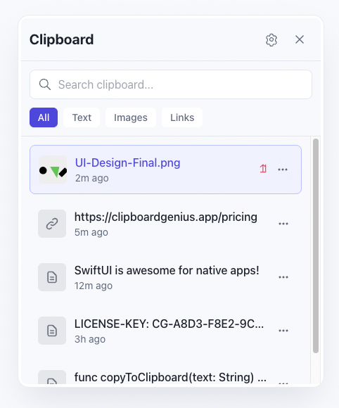

# Clipboard Manager for macOS

[](https://github.com/salimmous/clipboard-manager/releases/latest)
[](https://github.com/salimmous/clipboard-manager)
[](https://swift.org)
[](#license)

A lightweight, fast, native macOS menu bar clipboard manager built with Swift and SwiftUI. Runs silently in your menu bar with instant search, on-device Vision OCR, password manager privacy protection, hex color previews, direct auto-paste, and zero external dependencies.

<p align="center">
  
</p>

---

## Installation

### Option 1: Download DMG Installer (Recommended)
1. **[Download ClipboardManager v1.4.4 DMG Installer](https://github.com/salimmous/clipboard-manager/releases/latest/download/ClipboardManager-1.4.4-Installer.dmg)**
2. Open `ClipboardManager-1.4.4-Installer.dmg`
3. Drag **ClipboardManager** into your **Applications** folder

### Option 2: One-Line Terminal Install
```bash
curl -fsSL https://raw.githubusercontent.com/salimmous/clipboard-manager/main/install.sh | bash
```

### Option 3: System-Wide Installation (All Users)
```bash
curl -fsSL https://raw.githubusercontent.com/salimmous/clipboard-manager/main/global-install.sh | bash
```

### Option 4: Build from Source
```bash
git clone https://github.com/salimmous/clipboard-manager.git
cd clipboard-manager
make app-bundle
open ClipboardManager.app
```

---

## What's New in v1.4.x

- **Native macOS Settings UI:** Translucent macOS System Settings-style sidebar across 6 sections (`General`, `Appearance`, `Privacy & Data`, `Integrations`, `Updates`, `About`) with a visual 7-theme swatch picker.
- **Configurable Global Shortcut:** Defaults to **`⌘⇧V`** (no longer overrides macOS `⌘X` Cut) with instant switching between `⌘⇧V`, `⌥⌘V`, `⌃⌥V`, `⌘⇧C`, or legacy `⌘X`.
- **macOS Concealed Pasteboard Privacy:** Respects `org.nspasteboard.ConcealedType`, `TransientType`, and `AutoGeneratedType` markers in addition to an editable app Bundle ID exclusion list.
- **Pause / Incognito Mode:** Pause clipboard capture for 15 minutes, 1 hour, or until resumed right from the menu bar.
- **Launch at Login:** Native macOS `SMAppService` startup toggle in Settings.
- **Fast Storage & Rendering:** Compressed PNG image storage with async `NSCache` thumbnails, orphan file cleanup, jump-free smooth scrolling, and atomic JSON history storage (`history.json`) with automatic migration from legacy `UserDefaults`.
- **Reliable Auto-Updater:** Hardened GitHub Releases DMG updater with dynamic mount detection, bundle ID verification, and atomic rollback.

---

## Key Features

### Privacy & Security
- **Concealed & Transient Pasteboard Filtering:** Automatically skips sensitive entries copied from password managers and browser extensions.
- **Editable App Exclusion List:** Preconfigured for 1Password, Apple Passwords, Keychain Access, Bitwarden, LastPass, Dashlane, KeePassXC, MacPass, Enpass, and Proton Pass — add or remove any Bundle ID in Settings.
- **Pause / Incognito Mode:** Temporarily suspend history recording with a visible status indicator in the menu bar and popup.
- **100% Local Storage:** All history lives locally in `~/Library/Application Support/ClipboardManager/` (`history.json` + `Images/`) with zero analytics or tracking.

### Speed & Productivity
- **Direct Auto-Paste (`Enter`) & Plain Text (`⇧Enter`):** Automatically reactivates your previous app and pastes via `CGEvent` (with graceful fallback and quick Accessibility permission prompt).
- **Quick Paste (`⌘1`–`⌘9`):** Paste any of the top 9 filtered items instantly from the keyboard.
- **Smart Popup Placement:** Opens near your cursor across Spaces and fullscreen apps, auto-focuses search, and dismisses when clicking outside.
- **Pinned Items Protection:** Pinned items stay at the top, are protected during history trimming and Clear actions, and survive Scheduled Auto-Clear.
- **Auto-Copy Screenshots:** Watches your macOS screenshot folder (`com.apple.screencapture`, `~/Desktop`, `~/Downloads`) and adds new screenshots automatically.

### Vision OCR, Quick Look & Smart Detection
- **On-Device Apple Vision OCR:** Extracts text from copied images and screenshots asynchronously so you can search *inside* images.
- **Quick Look Overlay (`⌘Y` or `Space`):** Inspect full-resolution images, full text, extracted OCR text (with one-click copy), color cards, and smart actions.
- **Smart Content Detection:** Automatically detects emails (`mailto:`), phone numbers (`tel:`), street addresses (Apple Maps), URLs (`NSDataDetector`), and hex color codes (`#RGB`, `#RRGGBB`, `#RRGGBBAA`) with live color swatches.

### Integrations & Maintenance
- **Share Menu:** Send clipboard items directly to **Slack**, **Discord**, your preferred **Email client** (Mail, Outlook, Gmail, Spark), or **Notes app** (Apple Notes, Notion, Obsidian, Bear, DEVONthink).
- **Scheduled Auto-Clear:** Automatically prune unpinned items older than 1 hour up to 1 week.
- **Built-in Auto-Updater:** Checks GitHub Releases and installs updates cleanly.

---

## Keyboard Shortcuts

| Shortcut | Action |
| --- | --- |
| **`⌘⇧V`** *(configurable)* | Toggle Clipboard Manager popup from any app |
| **`⌘1` – `⌘9`** | Instant paste top 9 visible items |
| **`↑` / `↓`** | Navigate items while typing in search |
| **`Enter`** | Direct paste (or copy) selected item |
| **`⇧Enter`** | Paste selected item as plain text |
| **`⌘Y`** / **`Space`** | Toggle Quick Look preview (`Space` when search is empty) |
| **`⌘P`** | Pin or unpin selected item |
| **`⌘⌫`** | Delete selected item |
| **`Esc`** | Close Quick Look → clear search → hide popup |

---

## Permissions

- **Accessibility** *(optional, for Direct Auto-Paste)*: Open **Settings → General → Grant Permission** (or *System Settings → Privacy & Security → Accessibility*) and enable **ClipboardManager**. Without Accessibility permission, selecting an item still copies it to your clipboard cleanly.
- **Notifications** *(optional)*: Used for copy confirmations and update alerts.

---

## Project Structure & Development

```text
Sources/
├── ClipboardManager/             # Thin @main executable entry point
└── ClipboardManagerCore/         # Testable Swift library
    ├── Models/                   # AppInfo, AppSettings, ClipboardItem
    ├── Managers/                 # ClipboardManager (monitoring, storage, popup window)
    ├── Services/                 # OCR, PasteService, SmartDetector, ImageStorage, Updater, Sync, Integrations, ScreenshotWatcher
    └── Views/                    # ClipboardPopupView, QuickLookPreviewView, SettingsView, MenuBarView
Tests/
└── ClipboardManagerTests/        # XCTest unit suite
```

### Common Commands
```bash
swift test                  # Run unit test suite
swift run                   # Run debug build
make app-bundle             # Build release ClipboardManager.app
make create-dmg             # Package signed/ad-hoc Installer DMG
./deploy.sh                 # Test, build, package, and publish GitHub Release
```

> See [CHANGELOG.md](CHANGELOG.md) for full release history.

---

## License

Copyright © 2026 Salim Moustanir. All rights reserved.  
Licensed under the MIT License.
